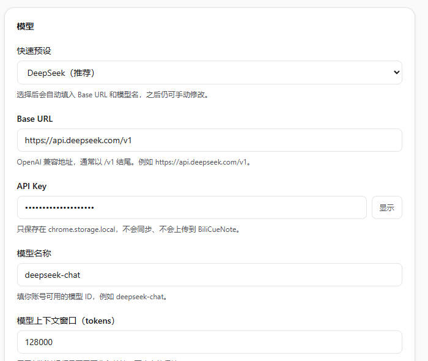
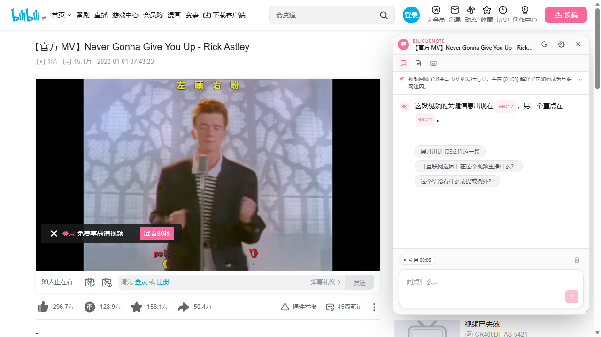
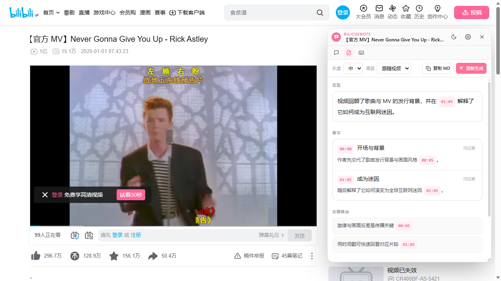
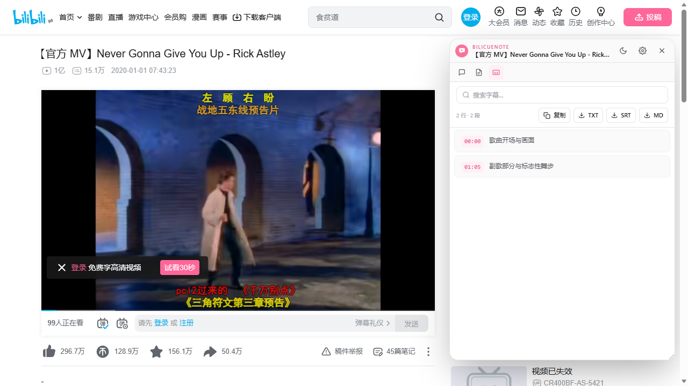
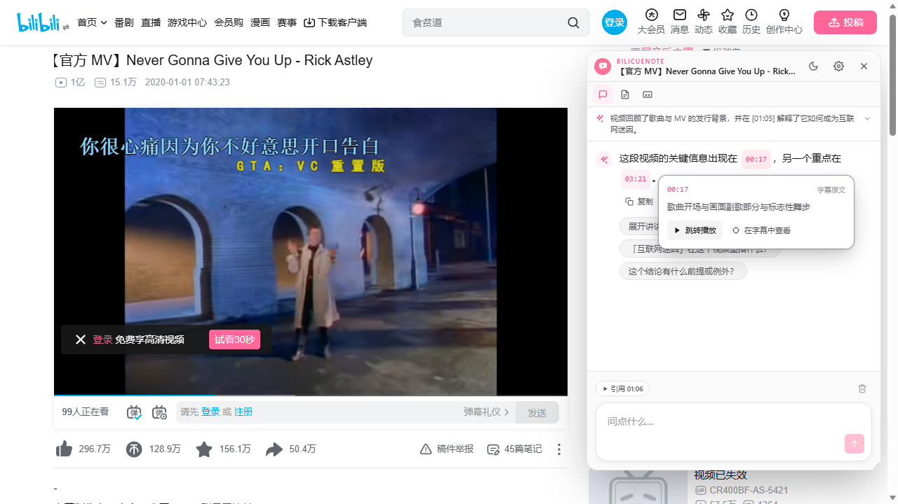
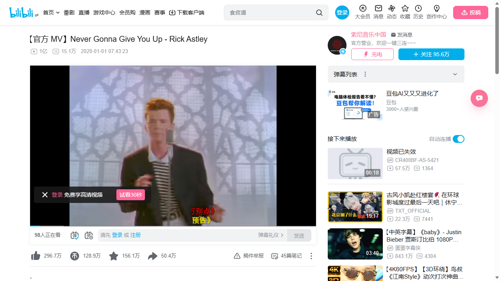
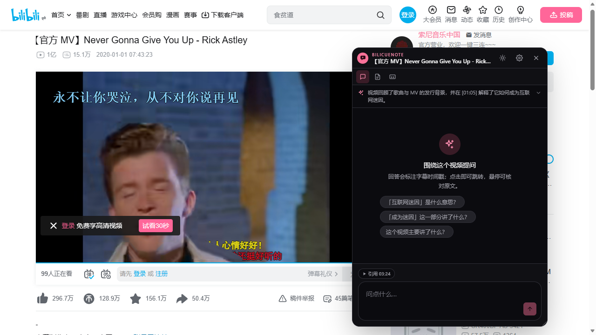

# BiliCueNote

用你自己的 OpenAI 兼容模型，把 B 站视频字幕变成带时间戳的摘要、可搜索的全文，以及只依据字幕回答的对话。

- 摘要：一句话总览、带时间戳的章节、关键要点与术语表，长度可选简 / 中 / 详。
- 字幕：全文按段落展示，支持搜索、点击跳转、复制，以及导出 TXT / SRT / Markdown。
- 对话：只依据字幕回答，每条回答附可点击的时间戳，悬停可以核对原文；视频没提到的内容会明确说明。
- BYOK：填自己的 Base URL / API Key / 模型名，支持 DeepSeek、OpenAI、通义千问、OpenRouter、Ollama 等兼容端点。
- 本地优先：字幕、摘要和对话缓存在本机 IndexedDB，无后端、无账号、无遥测。
- 悬浮窗：可拖动、可缩放、记住位置，跟随 B 站亮暗主题。

> 说明：本项目主要由 AI 编程助手构建，作者负责需求、设计与验收。

## 快速开始

从 [Releases](https://github.com/rhyme-sun/video-summarizer-for-bilibili/releases/latest) 下载最新的 zip。压缩包里是构建好的扩展，不需要安装 Node.js，也不需要自己构建。

把下面这段话交给你的 AI 编程助手（Claude Code、Cursor、Codex 等），让它帮你装好：

```text
请帮我安装 BiliCueNote：从 https://github.com/rhyme-sun/video-summarizer-for-bilibili/releases/latest 下载最新的 zip 并解压，然后在 Chrome 或 Edge 打开 chrome://extensions，开启开发者模式，点「加载已解压的扩展程序」，选择解压后的文件夹。能代劳的步骤直接完成，只有必须由我操作的浏览器界面再简短告诉我。装好后打开扩展设置页，提醒我填写 Base URL、API Key 和模型名。
```

首次使用，在设置页填写 OpenAI 兼容端点的 Base URL、API Key 和模型名即可，配置只保存在本机。保存时浏览器会请求该 API 域名的可选访问权限，用来绕过 CORS；点「测试连接」可以先验证配置。



> 截图里是模型配置区域：可以选预设，也可以手动填写。

## 功能介绍

### 摘要

生成结构化摘要：一句话总览、带时间戳的章节、关键要点与术语表。长度分简 / 中 / 详，输出语言默认跟随视频。长视频会按上下文阈值自动分段摘要再合并，界面会显示分段进度；生成中可以停止，重新生成失败时旧摘要仍然可读。

### 字幕

完整字幕按时间间隔分段展示，支持搜索、点击时间戳跳转、复制，以及导出 TXT / SRT / Markdown。在对话里点「在字幕中查看」，会自动滚动到对应段落并高亮。

### 对话

默认视图就是对话。每条回答至少引用一个时间戳，点击跳转播放，悬停显示字幕原文，也能一键定位到字幕视图。回答下方提供「复制 / 重新生成 / 再展开」，并根据引用时间戳、摘要术语和章节生成 2~3 条追问建议。对话历史按视频保存在本地，可一键清空。

### 页面内集成

B 站视频页右侧有 44px 圆形入口，点开后是可拖动、可缩放的悬浮窗（默认 420×640，位置和尺寸会记住）。面板挂在 Shadow DOM 中，不依赖 B 站布局；明暗主题默认跟随页面，也可以在顶栏一键固定为浅色或深色。切换视频或分 P 时会自动重置。

## 界面预览

| 对话                              | 摘要                                 |
| --------------------------------- | ------------------------------------ |
|  |  |

| 字幕                                    | 引用核对                                            |
| --------------------------------------- | --------------------------------------------------- |
|  |  |

| 页面入口                                     | 深色主题                                  |
| -------------------------------------------- | ----------------------------------------- |
|  |  |

> 示例内容为演示数据。

## 隐私

- 不读取、不上传 B 站 `SESSDATA`；字幕请求依赖浏览器自动携带的登录 cookie。
- 没有后端和遥测；字幕、视频标题与时长、摘要、对话历史和你的提问会发送到你填写的模型端点。
- 字幕、摘要和对话缓存在本机 IndexedDB，设置页可以一键清除。
- API Key 只存在 `chrome.storage.local`，不写日志，也不会进入页面上下文。

## 已知限制

- 仅支持 B 站普通视频（含分 P / 合集，当前 P），不支持番剧、直播和课程。
- 依赖 B 站播放器接口与 WBI 签名；B 站改版或风控可能导致失败，失败时会提示，不会无限重试。
- 没有字幕的视频不做 ASR 兜底；B 站正在生成 AI 字幕时会提示稍后再试。
- 全屏播放时悬浮窗不可见（v1 未处理），退出全屏后可以重新打开。
- 摘要质量取决于字幕质量和模型；AI 字幕可能没有标点，也可能有同音字错误。

## 文档

- [核心功能设计](docs/design.md)
- [开发与测试](docs/development.md)

## 许可证

本项目采用 [PolyForm Noncommercial 1.0.0](LICENSE)，仅限非商业用途，可自由用于个人学习、研究和其他非商业场景。
